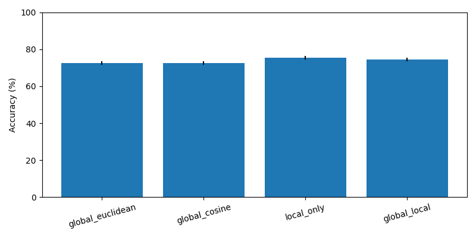
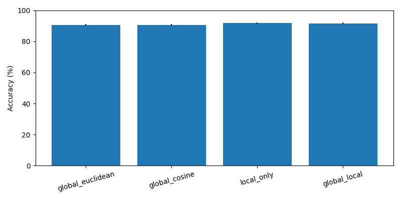

# Part-Aware Few-Shot Fine-Grained Image Recognition

**CS-UCS532 — Open Challenge | Problem P13**

**Student:** Ayush Raj Singh (1024030133) — individual submission

## Problem and research question

Fine-grained recognition distinguishes visually similar categories using subtle visual differences. This project investigates whether spatial activation-weighted local features improve prototype-based recognition when only one or five labelled examples of a new bird category are available.

## Dataset

[CUB-200-2011 (official dataset)](https://www.vision.caltech.edu/datasets/cub_200_2011/) contains 200 bird species and 11,788 images. A custom fixed class split (seed 18) assigns 100 base, 50 validation and 50 test classes. Only images from the 50 test classes are encoded in this implementation; the base and validation classes are not used for training or tuning. The exact split is recorded in `results/split.json`. Download the dataset separately; it is not included in this repository.

## Installation and reproduction

Python 3.10–3.12 is recommended. Clone the repository and install dependencies:

```bash
git clone https://github.com/ayush159-crew/Few-Shot-Fine-Grained-Recognition.git
cd Few-Shot-Fine-Grained-Recognition
pip install -r requirements.txt
```

Extract the official dataset so `data/CUB_200_2011/images/` exists. The first run requires internet access to download the torchvision pretrained ResNet-18 weights. CUDA is used automatically when available; CPU execution is supported. Windows users can use Git Bash with the same Python environment.

Reproduce the main table, ablation, plots and logs with:

```bash
bash run_all.sh
```

For a different dataset location, set `CUB_ROOT` before running the script. Outputs are written to `results/`. Preserve the submitted logs before rerunning if you need to compare runs. Exact numerical agreement across software and hardware environments is not guaranteed; independent fresh-clone reproduction is still pending.

## Method

A frozen ImageNet-pretrained ResNet-18 extracts spatial feature maps. Global features use average pooling; local features use spatial weights derived from activation magnitude followed by weighted pooling. Both embeddings are L2-normalized. Class prototypes are the means of support embeddings. Query classification uses nearest prototypes under squared Euclidean distance or cosine similarity. The proposed combined method averages global and local cosine scores with equal weights. The local weighting is a saliency proxy, not a verified anatomical part detector.

## Experimental protocol

- 5-way 1-shot and 5-way 5-shot classification.
- 15 disjoint query images per class (75 queries per episode).
- Seeds: 42, 123, 2026; split seed: 18.
- 200 episodes per seed per shot setting, 600 per method per setting.
- Identical episodes across methods; 4,800 recorded method-episode evaluations in total.
- No CUB training or validation tuning in the implemented pipeline.
- Metric: mean episode accuracy with approximate 95% episode-level confidence interval half-width.

## Main results

Recorded experiment, 25 November 2026. Values are percentages, rounded to two decimal places, from `results/main_table.csv`.

| Method | 5-way 1-shot | 5-way 5-shot |
| --- | ---: | ---: |
| Global prototype (Euclidean) | 72.44 ± 0.94 | 90.65 ± 0.53 |
| Global prototype (Cosine) | 72.44 ± 0.94 | 90.65 ± 0.53 |
| Local-only prototype | **75.26 ± 0.94** | **91.70 ± 0.48** |
| Proposed global + local | 74.43 ± 0.94 | 91.50 ± 0.49 |

The combined method improves over global cosine by 1.99 percentage points in 1-shot and 0.85 percentage points in 5-shot. Local-only achieves the highest observed accuracy in both settings. Statistical significance has not been established.

## Ablation study

| Representation | 1-shot accuracy (%) | 5-shot accuracy (%) |
| --- | ---: | ---: |
| Global only (cosine) | 72.44 | 90.65 |
| Local only | **75.26** | **91.70** |
| Global + local | 74.43 | 91.50 |

The ablation suggests that activation-weighted pooling is useful in this setting. Contrary to the expectation that combining features would be most beneficial, local-only performs best. Global information may dilute useful local cues, but this explanation has not been experimentally established.





## Failure analysis

The most frequent directed confusions for the combined method, aggregated across both shot settings and all seeds, are:

| True class | Predicted class | Error count |
| --- | --- | ---: |
| Field Sparrow | Grasshopper Sparrow | 91 |
| Canada Warbler | Cape May Warbler | 75 |
| Red-eyed Vireo | Warbling Vireo | 74 |

These are repeated episodic error occurrences, not necessarily distinct images or class-normalized error rates. See `results/failures.csv` for query paths and `results/failure_pairs.csv` for counts. Visual causes require further inspection.

## Hardware and runtime

| Item | Recorded value |
| --- | --- |
| Environment | Google Colab |
| GPU | NVIDIA Tesla T4 |
| Device | CUDA |
| PyTorch | 2.14.1+cu130 |
| Evaluation runtime | 29.73 seconds |

Runtime is the evaluator's recorded elapsed time, excluding environment setup and dataset download. See `results/run_metadata.json` and `results/run.log`. Other exact dependency versions were not recorded; `requirements.txt` specifies compatible ranges.

## Offline demo

```bash
streamlit run app.py
```

Select 2–5 classes, provide exactly 1 or 5 labelled support images per class, upload a query image and click Predict. The app uses combined cosine scores, not calibrated probabilities. Install dependencies and cache the pretrained weights before disconnecting from the internet. Offline operation must still be tested on the viva laptop.

## Changes from the proposal

The original direction was to investigate whether combining global and part-aware features improves recognition. Dataset preparation, baseline evaluation, end-to-end local feature evaluation and ablation produced recorded outputs. The stronger trained backbone gate was not implemented as proposed: the actual system uses a frozen ResNet-18 and compares global Euclidean and cosine scoring. Base-class training, augmentation experiments, semantic part detection and secondary datasets were not implemented. Spatial activation weighting replaces explicit anatomical part detection. The combined method improves on the global baseline, but local-only performs best. The final clean-setup reproduction gate remains unverified.

## Limitations

- One dataset and one custom class split; generalization to other domains is untested.
- Possible semantic overlap between ImageNet pretraining and CUB test categories.
- Activation magnitude does not guarantee meaningful anatomical localization.
- Repeated episodes share images; approximate confidence intervals are descriptive, not independent dataset-level uncertainty.
- No paired significance test, calibrated confidence estimates or independent reproduction yet.

## Repository structure and evidence

- `src/model.py`: feature extraction and prototype scoring.
- `evaluate.py`: dataset split, episodic evaluation, tables and failure analysis.
- `run_all.sh`: one-command evaluation and logging.
- `app.py`: Streamlit demonstration.
- `requirements.txt`: dependencies.
- `results/`: main table, ablation, episode records, failure records, plots, split and run metadata/log.
- `AI_DECLARATION.md` and `CONTRIBUTIONS.md`: declarations to be reviewed and signed by the student.

## Credits and references

- Wah et al. (2011), [The Caltech-UCSD Birds-200-2011 Dataset](https://www.vision.caltech.edu/datasets/cub_200_2011/).
- He et al. (2016), [Deep Residual Learning for Image Recognition](https://arxiv.org/abs/1512.03385), CVPR.
- Snell et al. (2017), [Prototypical Networks for Few-shot Learning](https://arxiv.org/abs/1703.05175), NeurIPS.
- [Torchvision ResNet-18 implementation and pretrained checkpoint](https://docs.pytorch.org/vision/stable/models/generated/torchvision.models.resnet18.html) — `ResNet18_Weights.DEFAULT`.

No external baseline repository was copied in the starter implementation. The prototype concept and pretrained backbone are reused as credited above.

## Contribution and AI declaration

Ayush Raj Singh is the sole submitting student. ChatGPT generated the starter implementation, scripts and documentation and assisted with interpreting the experimental results and updating this README. The student ran the supplied experiments on Google Colab and supplied the resulting files. No claim is made that the student independently authored the AI-generated code. The student must review the code, verify reproducibility, document any additional changes or AI assistance, and sign the final contribution and AI declarations in accordance with course rules.

Repository: https://github.com/ayush159-crew/Few-Shot-Fine-Grained-Recognition
